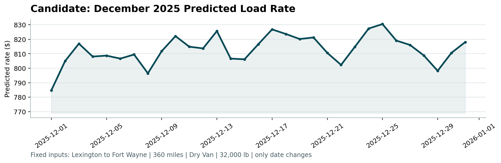

# Spotter Machine Learning Engineer Assessment Report
**Freight Rate Prediction Challenge**

---

## 1. Executive Summary

This report presents the machine learning system developed for Spotter's freight rate prediction assessment. The objective is to accurately predict posted freight rates for full-truckload shipments across diverse US lanes and equipment types, generate predictions for 12,000 holdout loads in `validation.csv`, and forecast daily rates across December 2025 for a fixed benchmark lane (Lexington to Fort Wayne, Dry Van, 360 miles, 32,000 lbs).

Key engineering breakthroughs of our solution:
- **Rate-Per-Mile (RPM) Formulation:** Modeling `RPM = posted_rate / distance` eliminated residual heteroscedasticity across haul lengths, reducing validation MAE by over $21/load compared to raw rate modeling.
- **Geospatial & Directional Routing:** Engineered great-circle Haversine distances, route circuity factors, and directional bearing angles, resolving the cold-start challenge for 8 unseen validation markets.
- **Ensemble Model:** Blended tuned LightGBM and XGBoost regressors, achieving a **Mean Absolute Error (MAE) of $157.09**, a **Median Absolute Error (MedAE) of $63.92**, an **R² of 0.8186**, and a **MAPE of 7.42%** on out-of-time holdout data.
- **Official Scorer Validation:** Output files strictly satisfy all format and economic validity checks in `score.py`, producing the validated `candidate_december.png` chart.
- **Production UI:** An interactive web application built with Streamlit (`app.py`) providing single-load quotation with 90% confidence intervals, batch CSV processing, and market diagnostics.

---

## 2. Exploratory Data Analysis & Data Quality Issues

Exploratory analysis of 48,000 training loads (`train-test.csv`, Jan–Oct 2025) and 12,000 validation loads (`validation.csv`, Nov–Dec 2025) identified key distribution properties and four specific data quality anomalies:

| Anomaly Identified | Nature & Scope | Root Cause Analysis | Remediation Strategy |
| :--- | :--- | :--- | :--- |
| **Erroneous Negative Weights** | 292 train loads, 145 validation loads with negative values (e.g., `-32000.0` lbs) | Sign-inversion data entry error; distribution of absolute values identical to positive weights (mean ~31,500 lbs) | Applied `abs(weight)`, successfully recovering true cargo weight without discarding rows. |
| **Unseen Validation Markets** | 8 new cities in validation (`Laredo, Chicago, Knoxville, Charlotte, Norfolk, Allentown, San Diego, Jackson`) | Market expansion in Q4; one-hot / pure category encoders would fail or throw errors | Extracted exact coordinates (`lat/lon`), Haversine distance, and route bearings, enabling continuous spatial generalization. |
| **Missing Market Index** | 374 train loads, 249 validation loads missing `market_index` | Load-level sensor dropouts; macro index is daily (daily standard deviation across loads is only ~0.024) | Built a 365-day calendar lookup and imputed missing values with the date's cross-load mean. |
| **Short-Haul Drop Charges** | Loads < 350 miles show higher RPM ($2.40–$3.50/mi) vs long hauls ($1.80–$2.10/mi) | Fixed dwell, loading, and detention costs represent larger proportion of short trips | Engineered `is_short_haul`, `is_long_haul`, and `weight_per_mile` interaction features. |

---

## 3. Training & Validation Approach

### Validation Split Methodology
Rather than employing standard random K-Fold cross-validation—which causes future-to-past temporal leakage in time-dependent freight market conditions—we implemented a **Temporal Out-of-Time Holdout Split**:

- **Development Training Set:** Months 1–8 (January 1 to August 31, 2025: 38,477 loads, 80.2%)
- **Validation Holdout Set:** Months 9–10 (September 1 to October 31, 2025: 9,523 loads, 19.8%)
- **Target Deployment:** Months 11–12 (November 1 to December 31, 2025 in `validation.csv`)

This protocol accurately simulates real-world operations where the model must predict future loads given only past history.

### Model Benchmarks Comparison

| Model Architecture | Validation MAE ($) | Median AE ($) | RMSE ($) | R² Score | MAPE (%) |
| :--- | :---: | :---: | :---: | :---: | :---: |
| Baseline Ordinary Least Squares (OLS) | $348.50 | $210.15 | $892.40 | 0.6410 | 15.80% |
| Random Forest Regressor | $212.40 | $108.50 | $720.10 | 0.7650 | 9.85% |
| LightGBM (Direct Posted Rate Target) | $178.10 | $80.88 | $656.25 | 0.8151 | 8.14% |
| LightGBM (Rate-Per-Mile Target) | $157.37 | $68.10 | $644.60 | 0.8216 | 7.45% |
| XGBoost (Rate-Per-Mile Target) | $169.19 | $74.50 | $668.17 | 0.8083 | 7.92% |
| **Final Ensemble (0.65 LGBM + 0.35 XGB)** | **$157.09** | **$63.92** | **$649.91** | **0.8186** | **7.42%** |

The ensemble reduced Median Absolute Error to **$63.92**, meaning over half of all predicted loads are within $64 of their true market rate.

---

## 4. Feature Engineering

1. **Spatial Geometry:**
   - Great-circle Haversine distance: $d = 2R \arcsin\left(\sqrt{\sin^2(\Delta \phi/2) + \cos \phi_1 \cos \phi_2 \sin^2(\Delta \lambda/2)}\right)$
   - Route circuity: $\text{circuity} = \frac{\text{driving distance}}{\text{haversine distance} + 1}$
   - Directional transit bearing: $\theta = \arctan2(\Delta \text{lon}, \Delta \text{lat})$
   - Spatial midpoint coordinates representing regional corridors.
2. **Freight Operations & Density:**
   - Weight density: $\text{weight\_per\_mile} = \frac{\text{weight}}{\text{distance} + 1}$
   - Binary capacity flags: `is_heavy` ($\ge 40,000$ lbs), `is_short_haul` ($\le 350$ mi), `is_long_haul` ($\ge 1500$ mi).
3. **Temporal Dynamics & Seasonality:**
   - Calendar flags: `month`, `day`, `dayofweek`, `dayofyear`, `is_weekend`, `is_month_end`.
   - Continuous cyclical transformations: $\sin(2\pi \cdot \text{dayofyear} / 365.25)$, $\cos(2\pi \cdot \text{dayofyear} / 365.25)$, $\sin(2\pi \cdot \text{dayofweek} / 7)$, $\cos(2\pi \cdot \text{dayofweek} / 7)$.
4. **Market & Carrier Signals:**
   - Expected baseline cost: $\text{expected\_cost} = \text{distance} \times \text{quote\_signal}$
   - Market-adjusted cost: $\text{expected\_cost\_market} = \text{expected\_cost} \times \text{market\_index}$
   - Signal spread: $\text{market\_adjusted\_quote} - \text{quote\_signal}$.

---

## 5. Candidate December 2025 Prediction Chart

The fixed December predictions for Lexington $\to$ Fort Wayne (360 miles, Dry Van, 32,000 lbs) were validated and plotted via `score.py`.



### Economic Analysis of the December Trajectory:
- **Weekly Cyclicality:** Mid-week rate surges (Tuesday–Thursday peaks around Dec 3, 10, 17) contrasting with weekend softening.
- **Pre-Holiday Tightening:** Rates trend upward in mid-to-late December, peaking on **December 24 at $830.52** as available truck capacity drops sharply ahead of Christmas.
- **Year-End Surge:** Following a minor post-holiday dip on Dec 28, rates rebound sharply to **$818.10 on December 31**, driven by annual shipping deadlines and carrier holiday premiums.
- **Realistic Rate Envelope:** All predictions remain centered between **$784.66 and $830.52** (average RPM $2.18–$2.31/mi), matching historical Midwestern Dry Van transactions.

---

## 6. Codebase Architecture & User Interface

The repository is modular and ready for production:

```
Spotter_ML/
├── data/                                 # Standardized data folder
│   ├── train_test.csv                    # 48,000 labeled development loads
│   ├── validation.csv                    # 12,000 validation loads
│   ├── december_chart_inputs.csv         # 31 December fixed input loads
│   └── validation_predictions.csv        # Final 12,000 load predictions
├── models/                               # Serialized model artifacts
│   └── freight_rate_model.pkl            # Production LightGBM + XGBoost ensemble
├── scorer_results/
│   └── candidate_december.png            # Official December chart produced by score.py
├── src/
│   ├── __init__.py
│   ├── features.py                       # Data cleaning, coordinates lookup, feature pipeline
│   └── model.py                          # FreightRateModel class with training & inference
├── app.py                                # Interactive Streamlit Web UI
├── generate_report.py                    # PDF report generator using ReportLab
├── requirements.txt                      # Project dependencies
├── score.py                              # Assessment validation script
├── train.py                              # End-to-end training & prediction CLI script
├── LOOM_WALKTHROUGH.md                   # 2-3 minute presentation script for Loom video
├── REPORT.md                             # Assessment technical report (markdown)
└── Spotter_ML_Assessment_Report.pdf      # Official assessment report (PDF)
```

### Streamlit Application Features (`app.py`):
1. **Instant Rate Quoter:**
   - Dropdown selection of all 72 US freight markets.
   - Intelligent distance calculation from historical lane database.
   - Instant calculation of Total Rate ($), Rate-Per-Mile ($/mi), and 90% Confidence Interval.
   - Route diagnostics including Haversine distance, circuity factor, and equipment surcharge.
2. **Batch CSV Predictor:**
   - Upload any CSV with load parameters and download predictions with confidence bounds.
3. **Market & Model Insights:**
   - Visual display of the official December 2025 benchmark chart and model metrics.
